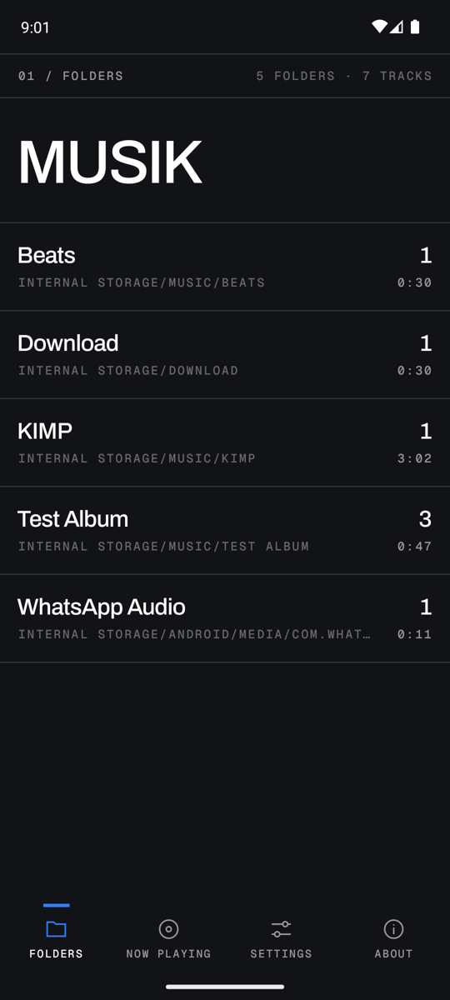
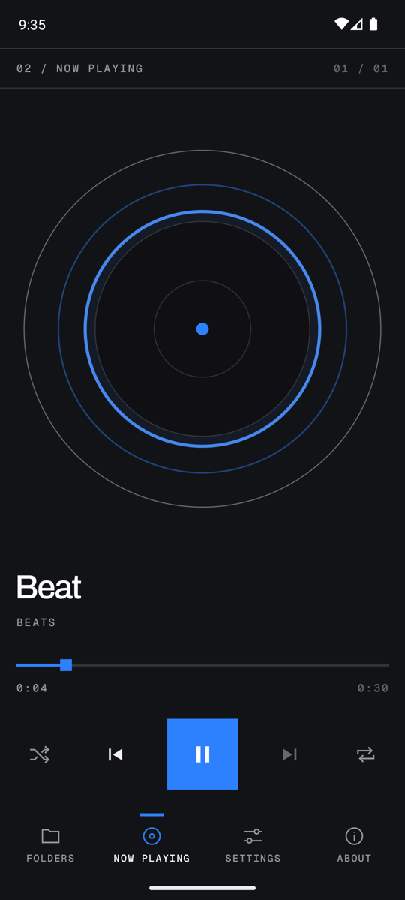

<h1 align="center">MUSIK</h1>

<b>An offline, folder-first music player for Android.</b> Your music, by the folder it's in. 
Developed by <b>Kim G. Decierdo</b>

<a href="../../releases/latest"><b>⬇ Download MUSIK for Android</b></a> <a href="https://mikdecierdo.github.io/MUSIK-download/">Website</a>

 &nbsp; 

This repository only hosts the **MUSIK app** for download. Get it from the [Releases](../../releases/latest) page.

## What MUSIK does
- **Folders first:** the library starts from the folders on your phone (Download, WhatsApp Audio, Music/…), in natural file order, with Songs, Artists, Albums and Genres too.
- **Plays in the background**, with notification and lock-screen controls. Headphone and Bluetooth buttons work, and it picks up where you left off.
- **Side menu:** Home, Play queue, Folders, Songs, Artists, Albums, Genres, Settings and About.
- **Home:** Shuffle all songs, your play queue and Recently played, with cover art from the files.
- **AutoMix:** songs blend into each other with a smooth crossfade.
- **Mini player:** a now-playing bar on every screen; swipe it up for the full player.
- **Play queue:** *Play next* or *Add to queue* on any song or folder, across folders.
- **Sleep timer:** the music fades out and stops after 15 to 90 minutes.
- **Equalizer:** the phone's presets, a custom curve and bass boost.
- **Hide folders** you don't want in the library (call recordings, ringtones, ...).
- **Bass visualizer:** a circular visualizer on Now Playing pulses with the bass.
- **Updates itself:** when a new version is out, MUSIK downloads it and Android asks you to install it.
- Light, dark or follow-the-system theme. No accounts, no tracking, nothing leaves your phone.

## Install
1. Download the **`MUSIK-x.y.z.apk`** file from the [latest release](../../releases/latest).
2. Open it and allow your browser or Files app to *install unknown apps* when Android asks.
3. Open MUSIK and allow access to your music. The visualizer asks separately for audio access; it only reads what MUSIK itself plays, the microphone is never used.

Android 10 or newer. Works fully offline; it only goes online to check this page for updates (you can turn that off).

## Responsible use
MUSIK plays audio files that are already on your phone. It doesn't stream, download or share music, and it doesn't unlock paid or copy-protected content. Keep to music you own, music that's free to use, or music you have permission to have. MUSIK isn't affiliated with any music service, label or artist. **You are responsible for how you use MUSIK.**

---

© 2026 Kim G. Decierdo. All rights reserved.
